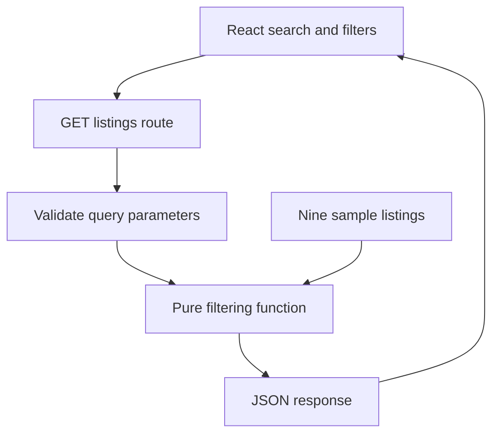

# Machinery Find

A heavy-equipment browsing demo with a Next.js App Router API and a TypeScript/React client. Search nine fictional sample listings by name, description, or location, combine category and condition filters, and inspect equipment details.

**Scope:** read-only catalog prototype. Inventory is checked-in sample data, not verified seller inventory. There is no database, authentication, seller messaging, listing creation, checkout, or payment integration.

## Engineering highlights

- A shared `Listing` model and pure filtering module keep inventory/query rules independent from the route handler and UI.
- `GET /api/listings` validates enum filters, maximum search length, safe integer prices, repeated parameters, and unknown query keys; invalid requests return 400 with a useful error.
- Search input is debounced 280 ms. Fetches are cancelled when filters change; aborted or stale requests cannot overwrite the current results.
- Loading, empty, network/error, and retry states are distinct. Keyboard-accessible equipment details replace the former nonfunctional “Contact Seller” button.
- Labeled search, pressed-state filters, result announcements, visible focus, reduced-motion handling, and a mobile-safe grid.
- Dependency upgrade from Next.js 16.2.4 to 16.4.3 with lockfile refresh. See [validation evidence](docs/VALIDATION.md) for the actual audit, build, and test results.

## Architecture



`lib/listings.ts` holds the shared model, sample inventory, and pure query logic. The route is a small HTTP adapter. The client uses a type-only model import; listing data remains behind the API. Filtering is O(n), which is appropriate for nine records. A real catalog would require persistent storage, indexed search, pagination, and a separate ingestion/admin workflow; a database is not added merely for appearance.

## Run and verify

Use Node.js 24 LTS (minimum 22.18 for native TypeScript test support) and npm.

```bash
npm ci
npm run dev
# Open http://localhost:3000
npm test
npm run lint
npm run typecheck
npm run build
npm run start
```

No application secrets or environment variables are required. `.env.example` documents this. Keep future deployment credentials out of the repository. `.gitignore` excludes private environment files while permitting the example.

To run the browser regression script against a local production server:

```bash
npx playwright install chromium
# Start npm run start in another terminal, then:
npm run test:http
npm run test:browser
```

The browser script checks loading, search, filters, invalid API requests, failed requests/retry, rapid query changes, equipment details, and small-screen overflow. Unit tests cover query logic; they do not substitute for a real API/browser check. CI performs tests, lint, typechecking, a production build, and a browser smoke check; it does not deploy.

## API

```bash
curl 'http://localhost:3000/api/listings'
curl 'http://localhost:3000/api/listings?category=Excavators&condition=Used&maxPrice=150000&search=Chicago'
curl 'http://localhost:3000/api/listings?maxPrice=12abc'  # HTTP 400
```

Response: `{ "listings": [...], "total": 9 }` for an unfiltered request. `search` is trimmed, case-insensitive, and at most 100 characters. `category` and `condition` accept the values shown in the UI, or `All`. `maxPrice` is a non-negative safe integer USD amount and is API-only for now. Unknown or repeated parameters are rejected. There is no pagination because the entire sample set contains nine records.

## Trade-offs, limitations, and next steps

React escapes listing text, there is no raw HTML injection, and the API reads only local data. That small attack surface is helpful, but it is not a production security certification. A public deployment still requires dependency updates, platform controls, monitoring, rate/body limits, and a threat review when writes or authentication are introduced.

Typography uses a Google Fonts CSS import with system fallbacks; slow font loading should not block browsing. Listing icons are illustrative emoji, not equipment photographs. Long catalogs need pagination and efficient queries; server-side rendering/search URL persistence are future options. A real seller workflow should be built and tested before adding a contact CTA again.

The configured Vercel URL responded during the audit; this branch has not been deployed and the deployment’s source revision is not verified. No throughput or Core Web Vitals benchmark is claimed. Full assistive-technology and cross-browser reviews remain open.
